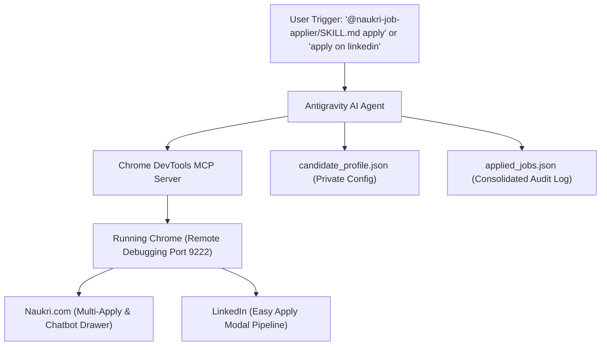

# 🤖 Autonomous Job Application Agent (Naukri & LinkedIn)

An autonomous agentic pair-programming workflow powered by **Antigravity** and **Chrome DevTools MCP** to discover, filter, autofill, and submit job applications across **Naukri.com** and **LinkedIn Easy Apply**.

---

## 📑 Table of Contents

1. [Overview & Architecture](#overview--architecture)
2. [Prerequisites](#prerequisites)
3. [Step 1: Clone / Pull the Repository](#step-1-clone--pull-the-repository)
4. [Step 2: Setup Chrome DevTools MCP](#step-2-setup-chrome-devtools-mcp)
5. [Step 3: Setup Candidate Profile & Private Data](#step-3-setup-candidate-profile--private-data)
6. [Step 4: Configure Preferences, Skills & CTC](#step-4-configure-preferences-skills--ctc)
7. [Step 5: How to Run Applications](#step-5-how-to-run-applications)
8. [Step 6: Git Hygiene — What to Push & Data Masking](#step-6-git-hygiene--what-to-push--data-masking)
9. [Pre-Push Masking Checklist](#pre-push-masking-checklist)

---

## Overview & Architecture



* **Core Target Technologies**: React, Next.js, TypeScript, JavaScript, Node.js, Express, .NET Core / C#.
* **Strict Filter**: Zero tolerance for Java / Spring / Spring Boot positions (automatically skipped).
* **Freshness Filter**: Only posts from the last 1 week or sooner (0–7 days max).
* **Screening Questionnaire Autofill**: 100% automated responses (never skips any question).
* **Safety & Deduplication**: Checks `applied_jobs.json` to prevent re-applying to previous jobs.

---

## Prerequisites

1. **Google Chrome** installed on your machine.
2. **Antigravity CLI / IDE** (or an MCP-capable agentic environment).
3. Active, logged-in accounts on **Naukri.com** and **LinkedIn** in your Google Chrome browser.

---

## Step 1: Clone / Pull the Repository

Clone or pull the repository to your local working directory:

```bash
git clone <YOUR_REPO_URL> job_search
cd job_search
```

If you are pulling updates on an existing machine:

```bash
git pull origin main
```

---

## Step 2: Setup Chrome DevTools MCP

The agent automates your existing Chrome session using the Chrome DevTools Protocol.

### 1. Launch Chrome with Remote Debugging

Close all existing Chrome windows, then open terminal and launch Chrome with remote debugging enabled:

* **macOS**:
  ```bash
  /Applications/Google\ Chrome.app/Contents/MacOS/Google\ Chrome --remote-debugging-port=9222
  ```
* **Linux**:
  ```bash
  google-chrome --remote-debugging-port=9222
  ```
* **Windows** (PowerShell / Command Prompt):
  ```cmd
  "C:\Program Files\Google\Chrome\Application\chrome.exe" --remote-debugging-port=9222
  ```

> [!TIP]
> Alternatively, open `chrome://inspect/#remote-debugging` in Chrome and verify the target server is listening on port `9222`.

### 2. Verify MCP Configuration

Ensure Chrome DevTools MCP is registered in your MCP configuration file (e.g., `~/.gemini/antigravity/mcp_config.json` or your project MCP settings):

```json
{
  "mcpServers": {
    "chrome-devtools": {
      "command": "npx",
      "args": ["-y", "@modelcontextprotocol/server-chrome-devtools", "--autoConnect"]
    }
  }
}
```

---

## Step 3: Setup Candidate Profile & Private Data

To protect your personal data, the repository tracks a sanitized markdown template ([candidate_profile.sample.md](.agents/skills/naukri-job-applier/references/candidate_profile.sample.md)) and JSON template (`candidate_profile.template.json`), while your actual personal profile (`candidate_profile.json`) is kept strictly local and ignored by git.

### 1. Sample Personal Details Reference Table

You can refer to or copy directly from the sample Markdown document ([candidate_profile.sample.md](.agents/skills/naukri-job-applier/references/candidate_profile.sample.md)) or use this reference table for cross-checking:

| Parameter | Placeholder | Generic Sample Value | Notes / Description |
| :--- | :--- | :--- | :--- |
| **Full Name** | `{{YOUR_FULL_NAME}}` | `Jane Doe` | Candidate legal / display name |
| **Email Address** | `{{YOUR_EMAIL}}` | `janedoe@example.com` | Primary application contact email |
| **Phone Number** | `+91-{{YOUR_PHONE}}` | `+91-9876543210` | Contact phone / mobile number |
| **Current Location** | `{{CURRENT_LOCATION}}` | `Bengaluru, India` | Current home / base city |
| **Preferred Locations** | `{{PREFERRED_LOCATIONS}}` | `Bengaluru, Hyderabad, Pune, Remote` | Target job locations |
| **Current CTC** | `{{CURRENT_CTC}}` | `20 LPA` (numeric `20`) | Current fixed package / CTC |
| **Expected CTC** | `{{EXPECTED_CTC}}` | `25–30+ LPA` (default `28 LPA`) | Target package range matching job budget |
| **Notice Period** | `{{NOTICE_PERIOD}}` | `Immediate / 0 days` | Notice period length |
| **Serving Notice?** | `{{SERVING_NOTICE}}` | `Yes` | Currently serving notice period |
| **Face-to-Face Interview** | `{{F2F_AVAILABLE}}` | `Yes / Available` | Willing to attend in-person rounds |
| **Core Skills** | `React`, `TypeScript`, `JavaScript` | `5` (Years / Rating) | Core frontend technologies |
| **Backend Skills** | `Node.js`, `Express`, `.NET Core` | `3` (Years / Rating) | Complementary backend stack |
| **Excluded Technologies** | `Java`, `Spring Boot` | `0` (Zero applications) | Strict exclusion filter (Skip completely) |

### 2. Create your local profile from template

```bash
# Option A: Create JSON profile from template
cp .agents/skills/naukri-job-applier/references/candidate_profile.template.json \
   .agents/skills/naukri-job-applier/references/candidate_profile.json
```

### 3. Add your Resume

Place your current resume PDF in the project root:

```bash
cp /path/to/your_resume.pdf ./resume.pdf
```

*(Note: `*.pdf` is included in `.gitignore` so your resume file is never accidentally committed).*

---

## Step 4: Configure Preferences, Skills & CTC

Verify that your `candidate_profile.json` and skills reflect your application rules:

### 1. Compensation (CTC) Rules

```json
"currentCTC": "20 LPA",
"currentCTCNumber": 20,
"expectedCTC": "28 LPA",
"expectedCTCNumber": 28,
"expectedCTCRule": "Align with employer budget across candidate range (e.g. 25, 26, 27, 28, 29, 30+ LPA; default 28 LPA)"
```

* When screening questionnaires ask for **Current CTC**: Inputs your numeric Current CTC (e.g., `20`).
* When asked for **Expected CTC**: Matches the employer's budget between your desired range (e.g., `25` and `30+` LPA; default `28 LPA` or `28`).

### 2. Interview Availability & Location

```json
"currentLocation": "Bengaluru",
"willingToRelocate": "Yes",
"faceToFaceInterview": "Yes",
"availableForFaceToFace": "Yes",
"inPersonInterviewAvailable": "Yes",
"noticePeriod": "Immediate / 0 days",
"servingNoticePeriod": "Yes"
```

* **Current Location**: `Bengaluru`.
* **Face-to-Face / In-Person Interview**: Answers **`Yes / Available`** for in-person rounds in Bengaluru.
* **Notice Period**: Answers `0` or `Immediate` (Serving notice period).

### 3. Mandatory Skills & Strict Exclusions

* **Allowed Stack**: `React`, `React.js`, `Next.js`, `TypeScript`, `JavaScript`, `Node.js`, `Express`, `.NET` / `C#`.
* **Strict Java Exclusion**: **Zero Java applications**. The agent automatically drops and skips any role mentioning `Java`, `J2EE`, `Spring`, `Spring Boot`, or `Java Full Stack` in the title or description.

### 4. Questionnaire Numeric Rating Rules

* **React / React.js**: `5`
* **JavaScript**: `5`
* **TypeScript**: `5`
* **Cloud / AWS / Azure / Docker**: `5`
* **Other secondary technologies**: `2–3` (default `3`)

---

## Step 5: How to Run Applications

Once Chrome is open with Naukri & LinkedIn logged in, you can start the automation directly inside Antigravity Chat:

### Apply on Naukri

Tag the skill or type:
```text
@naukri-job-applier/SKILL.md apply
```
*(Or simply: `"apply on naukri"`)*

The agent will:
1. Scan Recommended Jobs (`Handpicked`, `Preferences`, `Searches`).
2. Filter for React/TS/JS roles posted within 7 days.
3. Automatically skip all Java roles.
4. Check multi-apply boxes and submit.
5. Autofill screening questions in the chatbot drawer.
6. Log all applications to `applied_jobs.json`.

### Apply on LinkedIn (Easy Apply)

Tag the skill or type:
```text
@linkedin-job-applier/SKILL.md apply
```
*(Or simply: `"apply on linkedin"`)*

The agent will:
1. Search Easy Apply jobs across target cities (`Bengaluru`, `Hyderabad`, `Pune`, `Noida`, `Gurugram`).
2. Open matching job cards and launch the Easy Apply modal.
3. Fill contact information and verify resume.
4. Answer all screening questions dynamically without skipping.
5. Submit the application and record to `applied_jobs.json`.

### Apply on Both

```text
Apply on both LinkedIn and Naukri until 100 jobs are reached
```

---

## Step 6: Git Hygiene — What to Push & Data Masking

> [!CAUTION]
> **NEVER push your personal phone number, email, CTC numbers, or actual resumes to GitHub.**

### What MUST be committed to Git:

* `README.md`
* `.gitignore`
* `.agents/skills/naukri-job-applier/SKILL.md`
* `.agents/skills/naukri-job-applier/references/job_application_spec.md`
* `.agents/skills/naukri-job-applier/references/candidate_profile.template.json` *(masked)*
* `.agents/skills/linkedin-job-applier/SKILL.md`
* `.agents/skills/linkedin-job-applier/references/linkedin_spec.md`

### What MUST NEVER be committed to Git (kept local in `.gitignore`):

| File | Why It Is Ignored |
| :--- | :--- |
| `candidate_profile.json` | Contains actual personal contact details, email, and phone. |
| `*.pdf` / `resume.pdf` | Contains actual resume and confidential work history. |
| `applied_jobs.json` | Contains private application records and submission IDs. |
| `.env*` | Contains any local tokens or private environment variables. |

---

## Pre-Push Masking Checklist

Before running `git add` and `git commit`, run this verification script to guarantee no sensitive data is staged:

```bash
# 1. Verify git ignores private files
git status --ignored

# 2. Confirm candidate_profile.json and resumes are NOT staged
git status

# 3. Quick sanity check: Ensure template has masked values
grep -E "YOUR_FULL_NAME|your_email@example.com" \
  .agents/skills/naukri-job-applier/references/candidate_profile.template.json
```

### Initializing Git & Pushing for the First Time:

```bash
# Initialize repository (if not already initialized)
git init
git branch -M main

# Add only non-sensitive files
git add .gitignore README.md .agents/

# Commit
git commit -m "feat: setup autonomous job application skills with masked template"

# Add remote and push
git remote add origin <YOUR_GITHUB_REPO_URL>
git push -u origin main
```

---

## 🛡️ License & Compliance

This tool is designed for personal automation with human supervision. Always ensure compliance with the terms of service of the respective platforms.

